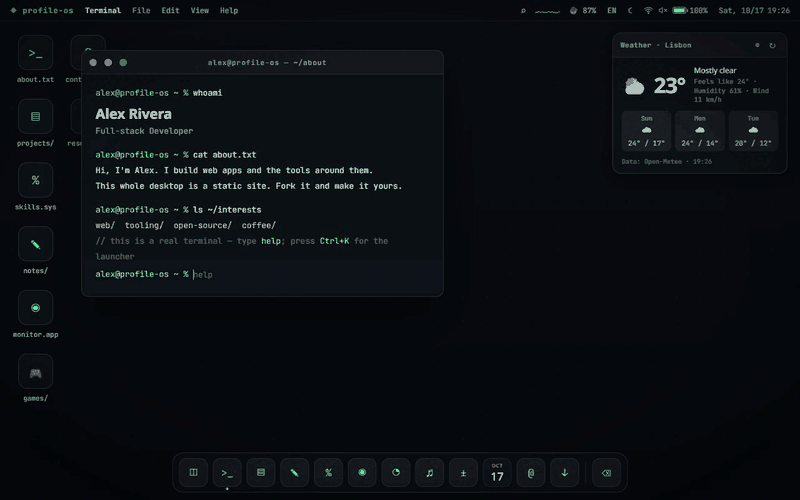

# profile-os

A personal website that behaves like a desktop operating system: boot screen, draggable windows, a terminal you can actually type in, a file manager with a writable filesystem, a music player, games, widgets, themes — in **10 languages**. It is a static site built with [Astro](https://astro.build) and plain TypeScript, with no frontend framework.

**Fork it and make it your own OS.** Everything personal lives in one folder: a `profile.yaml`, your PDFs and your notes. You choose which apps to show and which languages to build without touching the code.

Live demo (the example profile): **[profile-os.linjerry102039.workers.dev](https://profile-os.linjerry102039.workers.dev)** · [繁體中文說明](docs/README.zh-TW.md) · [Configuration reference](docs/configuration.md)



## Highlights

- **One YAML file.** Name, projects, skills, contacts, certificates, theme colours, startup windows and feature switches all live in `profile/profile.yaml`, validated at build time (a typo fails the build and names the field). A JSON Schema gives you autocompletion in VS Code.
- **10 UI languages.** English, 繁體中文, 简体中文, 日本語, 한국어, Español, Português (Brasil), Deutsch, Français, Русский — built with Astro's i18n routing. Your default language lives at `/`, the others at `/ja/`, `/de/`… Write your own content in as many languages as you like; anything you don't translate falls back to English. A language menu, `hreflang`, per-language fonts and a one-time "also available in your language" hint are built in.
- **Pick your apps.** Turn off the homelab monitor, the games, the CTF puzzle, the easter eggs or anything else with one line each; disabled apps vanish from the Dock, menus, terminal and file manager, and their code is never downloaded.
- **Fast.** Pure static HTML; the desktop core is ~29 KB of gzipped JS and each page downloads only its own language (a small cached JSON file). Each app (file manager, calculator, calendar, music, games…) is a 1–4 KB chunk that downloads the first time you open it.
- **Résumé first.** Visitors can land on your résumé window (rendered as crisp page images), with the terminal behind it. Deep links such as `/#projects/my-project` open a window directly and skip the boot animation.
- **A real terminal.** `ls`, `cd`, `cat`, `mkdir`, `touch`, `rm`, `mv`, `cp`, `echo > file`, `nano` (it saves), `grep`, `find`, `tree`, `ps`, `kill`, `neofetch`, `ping` (real latency), `lang`, Tab completion, history. Files you create show up in the file manager, stored in the visitor's browser.
- **Apps and games.** Terminal, file manager, projects, notes (Markdown), skills, task manager with live performance graphs, homelab monitor, music player (WebAudio-synthesized tracks), calculator, calendar, contacts, certificates, text editor, appearance settings — plus Snake, Dino, Minesweeper and 2048.
- **Looks.** 9 colour themes, custom accent, 7 animated canvas wallpapers, light/dark/auto, weather and sticky-note widgets.
- **SEO done.** Every project and note is also a standalone crawlable page with its own Open Graph image. Sitemap, robots.txt, canonical/hreflang and schema.org JSON-LD are generated for you.

## Quick start

```bash
git clone https://github.com/jerry102039/profile-os my-os
cd my-os
npm install
cp -r profile.example profile     # your own copy of the example profile
npm run dev                       # http://localhost:4321
```

Then edit `profile/profile.yaml`. Every field is commented; the [configuration reference](docs/configuration.md) explains each section, the feature switches, languages and deployment.

Other scripts: `npm run build` (static output in `dist/`), `npm run preview`, `npm run check` (type check), `npm test`, `npm run schema` (regenerate `profile.schema.json`).

Requires Node 20+. The build fetches font subsets from Google Fonts to render the Open Graph images, so it needs network access.

## Let AI write your profile.yaml

You don't have to fill in `profile.yaml` by hand. Any capable AI assistant (Claude, ChatGPT, Gemini…) can draft it from your résumé in a minute.

1. Open a new chat and attach (or paste) three things: [`profile.example/profile.yaml`](profile.example/profile.yaml) (the format, with comments), [`profile.schema.json`](profile.schema.json) (the exact rules) and your résumé — a PDF, or the text of your LinkedIn profile, GitHub README or CV.
2. Send the prompt below, after filling in the parts in `<angle brackets>`.
3. Save the answer as `profile/profile.yaml` and run `npm run dev` (or `npm run check`).
4. If the build stops with lines like `owner.email: Invalid email`, paste those lines back into the chat and ask the AI to fix only those fields. The schema names every bad field, so this usually takes one round.
5. **Read the result before you publish.** Everything in the file ends up on a public website. Check that nothing was made up, and remove what you don't want online (phone number, home address, birthday…).

```text
You are helping me write profile.yaml for profile-os, a personal website that looks like a desktop OS.
Attached: profile.example/profile.yaml (the format, with comments), profile.schema.json (the schema it must pass)
and my résumé.

Write my complete profile.yaml:
- Keep the structure, key names and comments of the example; replace Alex Rivera's content with mine.
- Use only facts from my résumé. Never invent jobs, numbers, dates, links or certificates.
  If something is unknown, leave the optional field out instead of guessing.
- site: name "<my OS name, e.g. alexOS>", url "<https://my.domain>", logo "<1–2 characters>",
  storageKey "<lowercase name>", defaultLocale <en>, locales [<en, ja, …>].
- owner.username: a short lowercase handle for the terminal (e.g. "alex").
- Write my texts in <English> (and <Japanese>, using the { en: …, ja: … } form where the
  wording differs by language). Keep them short: they appear in small windows.
- projects: my 2–6 strongest projects, each with title, desc, context, role, highlights,
  outcome and tags. Put the rest in moreProjects.
- skills: 4–6 entries with an honest pct (0–100).
- features: keep the defaults, except <e.g. status: false, ctf: false>.
- Do not include my phone number or home address.
- Reply with only the YAML, in one code block.
```

Using an AI coding agent in the repo (Claude Code, Cursor, Copilot…)? Put your résumé in the folder and ask: *"Read docs/configuration.md and profile.example/profile.yaml, then create profile/profile.yaml from resume.pdf. Only use facts from the résumé, leave out my phone number, and run `npm run check` until it passes."* The agent can run the build and fix its own mistakes.

## Your profile folder

```
profile/
  profile.yaml        everything personal + which apps and languages to build
  notes/en/*.md       notes, one folder per language (notes/ja/, notes/zh-Hant/ …)
  public/             copied to the site root: resume.pdf, certs/*.pdf, avatar.jpg, favicon.svg, …
```

The build uses `$PROFILE_DIR` if set, otherwise `profile/`, otherwise `profile.example/`.

Put `resume.pdf` and `certs/<file>.pdf` in `profile/public/`, then run `python scripts/certs-to-png.py` (needs `pip install pypdfium2`) to render the page images the résumé and certificate windows show.

**Want your PDFs out of git?** Keep the profile folder outside the repository and point `PROFILE_DIR` at it — see [deployment options](docs/configuration.md#deploy).

## Deploy

`dist/` is plain static files; any static host works. On Cloudflare (Workers & Pages → Create → Connect to Git): build command `npm run build`, output directory `dist` (or deploy command `npx wrangler deploy`, which uses `wrangler.jsonc`). Set `SITE_URL` if it differs from `site.url` in your profile. Details and the private-repo setup are in the [configuration reference](docs/configuration.md#deploy).

## Translations

UI strings live in `src/i18n/locales/<code>.ts`, checked against `en.ts` by TypeScript (a missing key fails `npm run check`). The non-English dictionaries other than Traditional Chinese were machine-assisted — **pull requests from native speakers are very welcome**. Adding a new language is described in the [configuration reference](docs/configuration.md#add-a-language).

## Project layout

```
profile.example/        the example profile (copy to profile/)
src/
  profile/              profile.yaml loader, zod schema, public/ copy integration
  i18n/                 dictionaries (locales/*.ts), locale helpers, plural/format helpers
  apps/registry.ts      which window / terminal command belongs to which feature switch
  components/           Desktop.astro (the whole desktop), Window.astro, ProjectDetail.astro
  layouts/              Base.astro (head, SEO, fonts, theme pre-paint), Doc.astro (standalone pages)
  pages/[...locale]/    the desktop, projects and notes for every enabled language
  pages/                404, OG image endpoint, sitemap, robots
  scripts/              core, wm (windows), terminal, vfs, theme, wallpaper, widgets, system, …
  scripts/apps/         lazy-loaded apps: finder, calculator, calendar, taskmgr, music, editor, games…
  styles/               base.css (tokens + themes), os.css (desktop), doc.css (pages)
scripts/                certs-to-png.py (PDF → images), gen-schema.ts (profile.schema.json)
homelab/                Cloudflare Worker + Proxmox push script for the live status window
```

## Browser support

Current Chrome, Edge, Firefox and Safari. Uses `color-mix()`, the Web Animations API, WebAudio, Canvas and `localStorage`. Battery and network details appear only where the browser exposes them (Chromium).

## Credits

Built by [Jerry Lin](https://github.com/jerry102039) with [Astro](https://astro.build), [satori](https://github.com/vercel/satori) and [resvg](https://github.com/yisibl/resvg-js) for the OG images, [pypdfium2](https://github.com/pypdfium2-team/pypdfium2) for PDF rendering, weather from [Open-Meteo](https://open-meteo.com), fonts [JetBrains Mono](https://www.jetbrains.com/lp/mono/) and [Noto](https://fonts.google.com/noto). The Dino game is a tribute to Chrome's offline T-Rex.

## License

[MIT](LICENSE). The example profile is yours to reuse. If you fork from someone's live site, replace their personal content (résumé, certificates, photos, write-ups) with your own.
